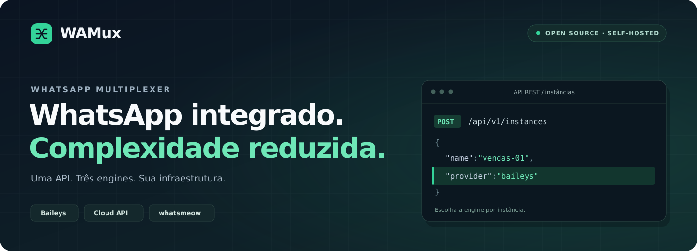
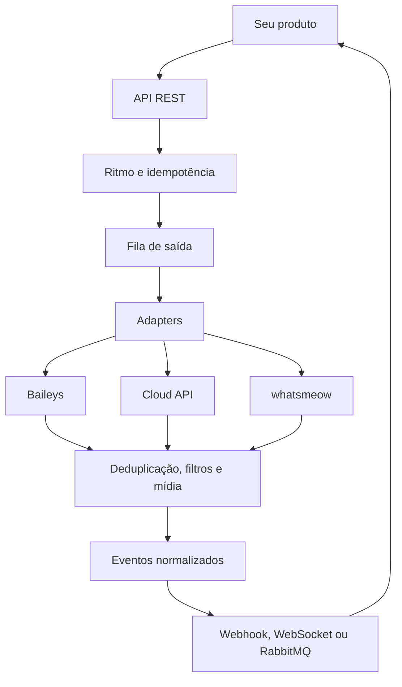

<a id="topo"></a>

<p align="center">
  
</p>

<h1 align="center">Uma integração. Três engines. Você no controle.</h1>

<p align="center">
  Conecte contas, envie mensagens e receba eventos por uma única API REST.<br />
  Escolha entre <b>Baileys</b>, <b>WhatsApp Cloud API</b> e <b>whatsmeow</b> por instância.<br />
  <b>Open source. Self-hosted. Licença MIT.</b>
</p>

<p align="center">
  <a href="LICENSE"></a>
  <a href="#comece"></a>
  <a href="#integracao"></a>
  <a href="#desenvolvimento"></a>
</p>

<p align="center">
  <a href="#comece"><b>Começar agora →</b></a> &nbsp;·&nbsp;
  <a href="#engines">Comparar engines</a> &nbsp;·&nbsp;
  <a href="#recursos">Explorar recursos</a> &nbsp;·&nbsp;
  <a href="#integracao">Ver a API</a> &nbsp;·&nbsp;
  <a href="ARCHITECTURE.md">Arquitetura</a> &nbsp;·&nbsp;
  <a href="https://www.rnbsolutions.com.br/">RNB Solutions ↗</a>
</p>

---

## O WhatsApp muda. Sua integração precisa acompanhar.

Bibliotecas diferentes, formatos de evento diferentes, sessões para gerenciar. Cada nova conexão pode trazer mais manutenção para o seu produto.

**O WAMux centraliza essa operação.** Um gateway para conectar contas oficiais e não oficiais, padronizar mensagens e eventos e escolher a engine de cada instância. Seu time constrói o produto sobre uma interface comum, respeitando as capacidades de cada provider.

<table>
  <tr>
    <td width="33%" valign="top">
      <h3>01 · Integre uma vez</h3>
      <p>Uma API REST e um modelo de eventos compartilhado entre as engines.</p>
    </td>
    <td width="33%" valign="top">
      <h3>02 · Escolha por conta</h3>
      <p>Defina o provider de cada instância e consulte os recursos disponíveis.</p>
    </td>
    <td width="33%" valign="top">
      <h3>03 · Acompanhe a operação</h3>
      <p>Painel, inbox, logs e status de entrega no mesmo projeto.</p>
    </td>
  </tr>
</table>

### Para quem está construindo

| Seu produto                           | Como o WAMux ajuda                                                         |
| ------------------------------------- | -------------------------------------------------------------------------- |
| **SaaS e CRMs**                       | Organize conexões por instância e ofereça integrações com acesso restrito. |
| **Atendimento**                       | Receba mensagens, responda e acompanhe entrega e leitura por eventos.      |
| **Bots e automações**                 | Conecte seu backend, n8n ou consumidores de filas a uma interface comum.   |
| **Notificações transacionais**        | Use idempotência, fila de saída, retry e rastreamento de status.           |
| **Operações com múltiplos providers** | Reúna contas Cloud, Baileys e whatsmeow no mesmo gateway.                  |

<a id="comece"></a>

## Comece em minutos

Um comando baixa o projeto e conduz a instalação:

```bash
curl -fsSL https://raw.githubusercontent.com/FaelN1/wamux/main/install.sh | bash
```

O instalador é interativo e faz, nesta ordem:

1. **Confere o que já está instalado** — sistema, git, Docker, Docker Compose v2 e se o Docker está rodando. No Linux sem Docker, oferece instalá-lo pelo script oficial.
2. **Baixa o projeto** na pasta escolhida (ou atualiza, se já existir).
3. **Pergunta as configurações** — domínio/URL pública, chave de administração (Enter gera uma forte), Inbox, painel de Logs, Cloud API (App Secret da Meta) e webhook global.
4. **Gera o `.env`** com senhas aleatórias para Postgres, RabbitMQ e sidecar, com permissão `600`.
5. **Configura o HTTPS** (opcional, Linux) — instala **nginx** e **certbot**, cria o proxy reverso para o seu domínio e pede o certificado do **Let's Encrypt**, com renovação automática.
6. **Sobe a stack** com `docker compose up -d --build`, espera a API responder e mostra os endereços e a chave de administração.

Ele não instala nada no sistema sem perguntar e nunca sobrescreve um `.env` sem backup. Para reconfigurar ou atualizar, rode de novo dentro da pasta: `./install.sh`.

#### HTTPS com domínio próprio

Requisitos: servidor Linux (apt ou dnf) com root ou sudo, um registro **A** do domínio apontando para o servidor e as portas **80** e **443** abertas. Com isso o instalador:

- publica um único domínio — `/api` e `/events` (WebSocket) vão para o gateway, o resto para o painel;
- define `PUBLIC_BASE_URL=https://seu-dominio` e `BIND_ADDR=127.0.0.1`, de modo que só o nginx fica exposto (o Docker publica portas por fora do `ufw`, então é o bind que fecha as demais);
- libera 80/443 no `ufw`/`firewalld`, se estiverem ativos, e pede a sua confirmação dos termos do Let's Encrypt.

Se o certificado não sair (DNS ainda propagando, porta 80 bloqueada), a instalação segue e o instalador mostra o comando para repetir só a emissão. Em macOS ou sem domínio, a stack sobe em `http://localhost` normalmente — mas a Meta só entrega webhooks e Flows em HTTPS.

#### Opções

| Opção             | Efeito                                                            |
| ----------------- | ----------------------------------------------------------------- |
| `--dir <pasta>`   | Pasta de instalação (padrão: `./wamux`).                          |
| `--branch <nome>` | Branch ou tag a instalar (padrão: `main`).                        |
| `--domain <host>` | Domínio para o HTTPS (nginx + Let's Encrypt).                     |
| `--email <email>` | E-mail da conta Let's Encrypt (avisos de expiração).              |
| `--agree-tos`     | Aceita os termos do Let's Encrypt — obrigatório junto de `--yes`. |
| `--yes`           | Sem perguntas: usa os padrões e gera os segredos.                 |
| `--no-start`      | Prepara tudo (`.env`, HTTPS), mas não sobe os containers.         |

Para passar opções pelo comando de uma linha, use `bash -s --`:

```bash
# servidor novo, sem perguntas, já com HTTPS
curl -fsSL https://raw.githubusercontent.com/FaelN1/wamux/main/install.sh | bash -s -- \
  --yes --dir /opt/wamux --domain wamux.suaempresa.com --email voce@suaempresa.com --agree-tos
```

Vale saber: a primeira subida constrói três imagens (5 a 15 minutos); as portas do host são fixas (o instalador avisa quando alguma está ocupada); e, se já existir um volume de banco de uma instalação anterior, ele avisa antes de gerar uma senha nova que não bateria com esse volume.

<details>
<summary><b>Instalação manual</b></summary>

Na raiz do projeto, copie a configuração e suba os serviços:

```bash
cp .env.example .env
# Configure as chaves e os secrets no .env antes de continuar.
docker compose up --build
```

</details>

**Abra o [painel em localhost:8080](http://localhost:8080)**, informe a `GLOBAL_API_KEY` (o instalador a mostra ao final; ela fica no `.env`) e crie sua primeira instância.

| Acesso                | Endereço local                                                |
| --------------------- | ------------------------------------------------------------- |
| **Painel**            | [localhost:8080](http://localhost:8080)                       |
| **API REST**          | [localhost:3000/api/v1](http://localhost:3000/api/v1)         |
| **Swagger**           | [localhost:3000/api/docs](http://localhost:3000/api/docs)     |
| **Health check**      | [localhost:3000/api/health](http://localhost:3000/api/health) |
| **RabbitMQ — gestão** | [localhost:15672](http://localhost:15672)                     |

O Compose inclui gateway Node.js, painel React, PostgreSQL, Redis, RabbitMQ e o sidecar Go do whatsmeow. O gateway também pode operar sem o painel, sem ativação manual e sem telemetria obrigatória.

### Sua primeira mensagem

**1. Crie uma instância.** Use a chave global configurada no `.env`.

```bash
API='http://localhost:3000/api/v1'
GLOBAL_API_KEY='SUA_GLOBAL_API_KEY'

curl -X POST "$API/instances" \
  -H "apikey: $GLOBAL_API_KEY" \
  -H 'Content-Type: application/json' \
  -d '{ "name": "vendas-01", "provider": "baileys" }'
```

**2. Conecte a conta.** Copie o `id` e a `apiKey` retornados na criação. Leia o QR Code com o WhatsApp.

```bash
INSTANCE_ID='ID_RETORNADO_NA_CRIACAO'
INSTANCE_API_KEY='API_KEY_RETORNADA_NA_CRIACAO'

curl -X POST "$API/instances/$INSTANCE_ID/connect" \
  -H "apikey: $INSTANCE_API_KEY"

curl "$API/instances/$INSTANCE_ID/qr" \
  -H "apikey: $INSTANCE_API_KEY"
```

O endpoint de QR retorna `qr` e `qrImage`. Você também pode conectar a conta pelo painel.

**3. Envie uma mensagem.** Substitua `to` pelo número de destino, com código do país e DDD.

```bash
curl -X POST "$API/messages/$INSTANCE_ID/text" \
  -H "apikey: $INSTANCE_API_KEY" \
  -H 'Content-Type: application/json' \
  -d '{
    "to": "5511999999999",
    "text": "Sua primeira mensagem com WAMux 🚀",
    "clientMessageId": "primeiro-envio-001"
  }'
```

O `clientMessageId` identifica o envio para idempotência. Use um valor diferente para cada nova mensagem.

<details>
<summary><b>Acompanhar a entrega da mensagem</b></summary>

Use o identificador da mensagem retornado pelo envio:

```bash
MESSAGE_ID='ID_DA_MENSAGEM'

curl "$API/messages/$INSTANCE_ID/status/$MESSAGE_ID" \
  -H "apikey: $INSTANCE_API_KEY"
```

Consulte as transições `pending → server_ack → delivered → read`, com timestamp por etapa, conforme os eventos disponibilizados pela engine.

</details>

<details>
<summary><b>Começar com a Cloud API oficial</b></summary>

Na criação da instância, use `provider: "cloud"` e as credenciais da conta Meta:

```json
{
  "name": "oficial-01",
  "provider": "cloud",
  "config": {
    "phoneNumberId": "SEU_PHONE_NUMBER_ID",
    "accessToken": "SEU_ACCESS_TOKEN"
  }
}
```

O fluxo de conexão da Cloud API usa a configuração da Meta e não passa por QR Code. Os requisitos de conta, templates e permissões continuam sendo definidos pela Meta.

</details>

<a id="engines"></a>

## Três engines. Uma superfície de integração.

Escolha o provider por instância. Consulte `GET /instances/:id/capabilities` para adaptar sua integração aos recursos disponíveis naquela conexão.

|                                    | Baileys              | Cloud API                             | whatsmeow     |
| ---------------------------------- | -------------------- | ------------------------------------- | ------------- |
| **Provider**                       | `baileys`            | `cloud`                               | `whatsmeow`   |
| **Conexão**                        | WebSocket em Node.js | HTTP — Meta Graph API                 | Sidecar em Go |
| **API oficial da Meta**            | Não                  | **Sim**                               | Não           |
| **Pareamento por QR**              | Sim                  | Não se aplica                         | Sim           |
| **Texto e mídia**                  | Sim                  | Sim                                   | Sim           |
| **Localização e contato**          | Sim                  | Sim                                   | Sim           |
| **Status / Stories**               | Sim                  | Não                                   | Sim           |
| **Grupos**                         | Sim                  | Sujeito à elegibilidade da Groups API | Sim           |
| **Comunidades e canais**           | Sim¹                 | Não                                   | Sim¹          |
| **Templates, Flows e gestão WABA** | Não                  | **Sim**                               | Não           |

¹ Nas comunidades, a operação de exclusão faz a conta sair; não apaga a comunidade para todos.

> **Limites dos providers:** a API é compartilhada, mas as engines não têm os mesmos recursos. A Cloud permite reações; edição e exclusão de mensagens não estão disponíveis nessa engine. Interativos dependem do provider e podem usar fallback para texto. Consulte as capabilities e o Swagger antes de integrar.

> **Status da integração Cloud:** a validação ao vivo depende de uma conta conectada. A Groups API tem requisitos próprios de elegibilidade, e seus bodies ainda precisam de confirmação em conta OBA real. Calling cobre sinalização; a mídia WebRTC fica fora do gateway.

> **Uso de engines não oficiais:** Baileys e whatsmeow não são APIs oficiais da Meta. Seu uso pode contrariar os Termos do WhatsApp e resultar em bloqueio da conta. Os controles de ritmo do WAMux não eliminam esse risco.

<details>
<summary><b>Migrar uma sessão entre Baileys e whatsmeow</b></summary>

O WAMux oferece migração de credenciais Multi-Device entre `baileys` e `whatsmeow`, preservando o vínculo com o dispositivo em sessões compatíveis.

```bash
curl -X POST "$API/instances/$INSTANCE_ID/provider" \
  -H "apikey: $INSTANCE_API_KEY" \
  -H 'Content-Type: application/json' \
  -d '{ "provider": "whatsmeow", "migrate": true }'
```

Essa portabilidade se aplica a Baileys ⇄ whatsmeow. A Cloud API tem seu próprio processo de configuração e credenciais.

</details>

<a id="recursos"></a>

## Explore o que vem no gateway

Do primeiro envio à operação diária: mensagens, conexões, eventos e visibilidade no mesmo projeto. **Abra uma categoria para ver os detalhes.**

<details>
<summary><b>Mensagens e mídia</b> — texto, arquivos, interativos e ações</summary>

- **Texto e mídia:** imagem, vídeo, áudio, documento e sticker, por URL ou base64. Inclui GIF, nota de voz PTT, vídeo-nota PTV e sticker animado. Payloads base64 grandes são tratados como stream.
- **Localização e contatos:** tipos de envio próprios para localização e vCard.
- **Status / Stories:** texto, imagem, vídeo e áudio, para todos os contatos ou uma lista específica, nas engines compatíveis.
- **Interativos:** enquetes com coleta e agregação de votos, botões, listas e botão PIX, conforme a engine. Fallback para texto quando aplicável e resposta `422` quando o envio não pode ser atendido.
- **Ações:** reação, edição e exclusão para todos, quando o protocolo permite.
- **Mídia recebida:** download por endpoint dedicado, em streaming ou base64.
- **Armazenamento:** disco local ou S3 compatível — AWS S3, MinIO e DigitalOcean Spaces — configurado por ambiente, com fallback para disco local.

</details>

<details>
<summary><b>Grupos, comunidades e canais</b> — gestão além da conversa individual</summary>

- **Grupos:** criação, metadados, participantes, promoção e remoção de admins, assunto, descrição, configurações, convites, entrada por link e saída.
- **Comunidades:** grupo-pai e subgrupos, nome, descrição, imagem, admins, membros agregados, convites, vínculo de grupos, anúncios com fan-out opcional e ressincronização.
- **Canais / Newsletter:** criação, seguir e deixar de seguir, metadados e publicação de texto, mídia e enquete.
- **Perfil:** nome e foto da conta conectada e consulta de foto de contato, grupo ou comunidade, conforme o provider e as regras de privacidade do WhatsApp.

</details>

<details>
<summary><b>WhatsApp Cloud API</b> — templates, Flows e gestão da conta Meta</summary>

- **Templates HSM:** criação, consulta, atualização, exclusão e envio com parâmetros posicionais ou nomeados; analytics e webhooks de status, qualidade e categoria. Templates de marketing podem sair pela **Marketing Messages API** (`route: "marketing"`) — veja [`docs/marketing-messages.md`](docs/marketing-messages.md).
- **Flows:** gestão com retorno de `validation_errors`, publicação, depreciação e envio com token de correlação; **endpoint de troca de dados criptografado** (o gateway cuida de RSA/AES e repassa JSON puro ao seu serviço), sessões persistidas, evento `flow.response` e página própria no painel. Guia: [`docs/whatsapp-flows.md`](docs/whatsapp-flows.md).
- **Conta e WABA:** perfil de negócio, números, registro, verificação, 2FA, informações da WABA, subscrição e override de webhook por número, e analytics de mensagens e de preço por mensagem (`pricing_analytics`).
- **Interativos nativos:** botões, listas e CTA; marcar como lido e indicador de digitação; bloqueio e desbloqueio; download de mídia.
- **Webhooks:** roteamento por `change.field` para mensagens, status, respostas de interativos, templates, grupos, chamadas, Flows e eventos de conta.
- **Graph API v26.0:** suporte a BSUID (usuários sem número exposto, envio por `recipient`), status `played`, preço por mensagem nos status e erros da Meta repassados com código, em vez de um 500 genérico.
- **Groups API e Calling:** endpoints sujeitos às condições e às pendências de validação descritas na seção de engines.

</details>

<details>
<summary><b>Eventos e integrações</b> — escolha como seu sistema recebe atualizações</summary>

| Transporte       | Uso                                                                                  |
| ---------------- | ------------------------------------------------------------------------------------ |
| **Webhook HTTP** | Receber eventos no seu backend, com assinatura HMAC-SHA256 e proteção contra replay. |
| **WebSocket**    | Atualizar aplicações em tempo real.                                                  |
| **RabbitMQ**     | Publicar eventos no broker para consumidores de filas.                               |

Configure os transportes e filtre os eventos por instância. Edições, reações e exclusões de mensagens também têm eventos normalizados.

</details>

<details>
<summary><b>Conexões e identidade</b> — sessões, contatos e histórico</summary>

- **Pareamento:** QR com TTL e proteção contra loops ou código de pareamento de 8 dígitos nas engines compatíveis.
- **Reconexão:** backoff, jitter e classificação de causa; acompanhamento de estado de Passkey.
- **Sessões:** persistência em PostgreSQL para preservar conexões saudáveis após restart. O boot da API não bloqueia aguardando a reconexão de todas as sessões.
- **Contatos:** bloqueio e desbloqueio, presença, marcar como lido, busca paginada de mensagens e etiquetas do WhatsApp Business.
- **Identidade:** resolução de `@lid ↔ número`.
- **Histórico:** importação assíncrona por intervalo de datas, com progresso e cancelamento.

</details>

<details>
<summary><b>Painel, Inbox e Playground</b> — teste e acompanhe pelo navegador</summary>

| Área                  | O que você faz                                                                                      |
| --------------------- | --------------------------------------------------------------------------------------------------- |
| **Instâncias**        | Crie conexões, leia QR Codes e acompanhe o status ao vivo.                                          |
| **Configuração**      | Ajuste eventos, controles de ritmo e API keys com escopo.                                           |
| **Inbox**             | Consulte conversas, contatos e mensagens persistidos em PostgreSQL, com atualizações por WebSocket. |
| **Mídia na conversa** | Visualize imagem, vídeo e documento; reproduza áudio; envie anexos com preview e progresso.         |
| **Logs / Atividade**  | Pesquise eventos entre instâncias, use filtros e histogramas e exporte os resultados.               |
| **Playground**        | Execute endpoints com a instância selecionada, visualize QR Codes e gere cURL.                      |

A persistência do Inbox é **opt-in por variáveis de ambiente**. Quando habilitada, o histórico persistido sobrevive a reinícios e pode ser consultado sem depender de uma sessão ao vivo.

</details>

## Mais controle sobre cada envio

| Quando isso acontece…                       | O gateway oferece…                                                           |
| ------------------------------------------- | ---------------------------------------------------------------------------- |
| Uma requisição de envio é repetida          | **Idempotência** por `clientMessageId`.                                      |
| O envio precisa de ritmo e novas tentativas | **Fila de saída**, pacing por instância, retry e DLQ reprocessável.          |
| Um evento de entrada chega novamente        | **Deduplicação** de entrada.                                                 |
| O endpoint de webhook apresenta falhas      | **Circuit breaker** por webhook.                                             |
| Um terceiro precisa enviar mensagens        | **API key com escopo**, sem compartilhar a chave mestra.                     |
| A operação precisa reduzir o ritmo          | **Perfis de risco**, warmup, auto-throttle e limites de consulta de números. |

<details>
<summary><b>Ver controles de acesso e segurança</b></summary>

- Autenticação por instância e whitelist/blacklist de JIDs na entrada e/ou saída.
- Webhooks assinados com HMAC-SHA256, proteção contra replay e segredo rotacionável.
- Webhooks de **entrada** autenticados: `X-Hub-Signature-256` da Meta (com `CLOUD_API_APP_SECRET`) e callbacks do sidecar whatsmeow assinados por HMAC — payload forjado é rejeitado com 401.
- Chaves com escopos `read`, `send`, `control`, `setting`, `app` e `delete`.
- Uma chave só pode delegar permissões que ela mesma possui.
- Perfis conservador, normal e agressivo; warmup de contas novas e auto-throttle por sinais de risco.
- Checagem de número com teto, cache e rate limit.

Os endpoints de configuração dos controles de risco usam o nome `anti-ban`. Eles não oferecem garantia contra bloqueio.

</details>

<a id="integracao"></a>

## Uma API que você pode explorar

O **[Swagger local](http://localhost:3000/api/docs)** reúne schemas e exemplos. O **Playground do painel** permite testar os endpoints antes de escrever a integração.

### Autenticação

Envie a chave no header `apikey`:

| Chave                       | Acesso                                       |
| --------------------------- | -------------------------------------------- |
| `GLOBAL_API_KEY`            | Administração do gateway.                    |
| API key mestra da instância | Acesso total à respectiva instância.         |
| API key com escopo          | Apenas as operações concedidas à integração. |

### Rotas essenciais

Os caminhos abaixo são relativos a `/api/v1`.

| Você quer…                      | Endpoint                              |
| ------------------------------- | ------------------------------------- |
| Criar uma conexão               | `POST /instances`                     |
| Conectar a conta                | `POST /instances/:id/connect`         |
| Ler o QR Code                   | `GET /instances/:id/qr`               |
| Descobrir os recursos da engine | `GET /instances/:id/capabilities`     |
| Enviar texto                    | `POST /messages/:id/text`             |
| Consultar a entrega             | `GET /messages/:id/status/:messageId` |
| Configurar eventos              | `PUT /instances/:id/events`           |
| Criar uma chave com escopo      | `POST /instances/:id/api-keys`        |

<details>
<summary><b>Explorar as demais áreas da API</b></summary>

Use o Swagger como referência completa de métodos, parâmetros e bodies. Nas famílias abaixo, os sufixos pertencem ao prefixo indicado.

| Área                          | Prefixo / caminhos de referência                                                                                                    |
| ----------------------------- | ----------------------------------------------------------------------------------------------------------------------------------- |
| **Instâncias**                | `/instances/:id` · `/connect` · `/qr` · `/pair-code` · `/provider` · `/capabilities`                                                |
| **Mensagens**                 | `/messages/:id` · `/text` · `/media` · `/poll` · `/buttons` · `/list` · `/pix` · `/location` · `/contact` · `/status`               |
| **Ações**                     | `/messages/:id` · `/reaction` · `/edit` · `/delete` · `/location-request`                                                           |
| **Grupos**                    | `/instances/:id/groups` · `/:jid/participants` · `/:jid/subject` · `/:jid/invite`                                                   |
| **Comunidades**               | `/instances/:id/communities` · `/:jid/admins` · `/:jid/groups` · `/:jid/announcement`                                               |
| **Canais**                    | `/instances/:id/newsletters` · `/:jid/follow` · `/:jid/message`                                                                     |
| **Perfil**                    | `/instances/:id/profile` · `/instances/:id/account/profile`                                                                         |
| **Cloud**                     | `/instances/:id` · `/templates` · `/flows` · `/account/*` · `/cloud-groups` · `/calling/*`                                          |
| **Eventos**                   | `/instances/:id/events` · `/instances/:id/webhook`                                                                                  |
| **Segurança**                 | `/instances/:id/filters` · `/instances/:id/webhook/dlq` · `/instances/:id/api-keys`                                                 |
| **Controles de risco**        | `/instances/:id/anti-ban` · `/instances/:id/anti-ban/status`                                                                        |
| **Contatos**                  | `/instances/:id/contacts/:jid/block` · `/instances/:id/presence` · `/instances/:id/numbers/check`                                   |
| **Etiquetas**                 | `/instances/:id/labels` · `/:labelId/associations`                                                                                  |
| **Identidade e configuração** | `/instances/:id/identity/resolve` · `/instances/:id/settings`                                                                       |
| **Inbox**                     | `/instances/:id/chats` · `/instances/:id/chats/:jid/messages` · `/instances/:id/chats/:jid/messages/db` · `/instances/:id/contacts` |
| **Atividade**                 | `/activity-logs` · `/facets` · `/histogram` · `/export` — escopo admin                                                              |
| **Histórico**                 | `/instances/:id/history/import` · `/instances/:id/history/import/:jobId`                                                            |
| **Download de mídia**         | `/messages/:id/media/:messageId`                                                                                                    |

Recursos não suportados pela engine retornam `501`. Alguns envios interativos podem retornar `422` quando não podem ser atendidos.

Health check e webhooks de entrada ficam **fora de `/api/v1`**: `/api/health` e `/api/webhooks/{cloud,whatsmeow}/:id`. A documentação fica em `/api/docs`.

</details>

<a id="desenvolvimento"></a>

## Feito para evoluir com o seu produto

O projeto usa adapters para manter as particularidades de cada engine fora do modelo compartilhado. Os tipos canônicos são usados pela API e pelo painel.

### Stack

| Camada             | Tecnologias                                                    |
| ------------------ | -------------------------------------------------------------- |
| **Gateway**        | Node.js ≥ 20 · NestJS 10 · TypeScript strict                   |
| **Painel**         | React · Vite · shadcn/ui                                       |
| **Dados e filas**  | PostgreSQL · Redis · BullMQ · RabbitMQ                         |
| **Engine Go**      | whatsmeow em sidecar                                           |
| **Infraestrutura** | Docker Compose · ffmpeg para conversão de áudio em nota de voz |
| **Monorepo**       | pnpm · Turborepo                                               |

<details>
<summary><b>Estrutura do repositório e comandos</b></summary>

| Diretório             | Responsabilidade                                           |
| --------------------- | ---------------------------------------------------------- |
| `apps/api/`           | Gateway NestJS — `@wamux/api`                              |
| `apps/web/`           | Painel React — `@wamux/web`                                |
| `packages/shared/`    | Tipos e enums canônicos — `@wamux/shared`                  |
| `packages/config/`    | Presets de TypeScript, ESLint e Prettier — `@wamux/config` |
| `services/whatsmeow/` | Sidecar Go, construído pelo Docker fora do pipeline Turbo  |

| Comando           | Função                                 |
| ----------------- | -------------------------------------- |
| `pnpm dev`        | Desenvolvimento em watch.              |
| `pnpm build`      | Build com Turborepo.                   |
| `pnpm lint`       | Verificação de lint.                   |
| `pnpm type-check` | Verificação de tipos.                  |
| `pnpm test`       | Testes com o runner nativo do Node.js. |

A suíte de testes usa um servidor WhatsApp simulado em processo e roda sem conta, telefone ou acesso à rede.

</details>

### Arquitetura

O fluxo de entrada passa por deduplicação, filtros e processamento de mídia antes da distribuição de eventos. Na saída, controles de ritmo e idempotência antecedem a fila. O registry distribuído coordena as conexões stateful.

<details>
<summary><b>Visualizar o fluxo de mensagens</b></summary>



</details>

**[Leia o detalhamento em ARCHITECTURE.md →](ARCHITECTURE.md)**

### Contribua

Issues e pull requests são bem-vindos. Consulte a [arquitetura](ARCHITECTURE.md) antes de começar e use [Conventional Commits](https://www.conventionalcommits.org/) nos commits.

### Licença

Distribuído sob a licença **[MIT](LICENSE)**. Use, modifique e distribua conforme os termos da licença.

---

<p align="center">
  <b>Menos integração para manter. Mais produto para construir.</b><br /><br />
  <a href="#comece">Começar com Docker</a> &nbsp;·&nbsp;
  <a href="#integracao">Explorar a API</a> &nbsp;·&nbsp;
  <a href="#topo">Voltar ao topo ↑</a><br /><br />
  <a href="https://www.rnbsolutions.com.br/"><b>RNB Solutions</b> · Software house</a>
</p>
